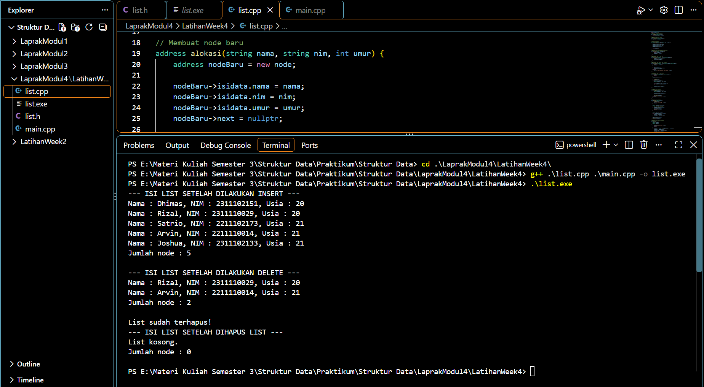
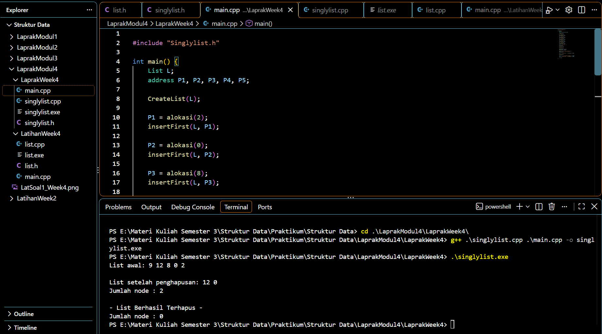

# LAPORAN PRAKTIKUM STRUKTUR DATA
## MODUL 04 — SINGLY LINKED LIST

**Mata Kuliah:** Struktur Data  
**Program Studi:** [S1 Informatika]  
**Fakultas:** [Fakultas Informatika]  
**Universitas:** Telkom University  

### Identitas Praktikan

| Keterangan | Data |
|---|---|
| Nama | [Rakhmat Pratama] |
| NIM | [109082530037] |
| Kelas | [S1IF-13-01] |
| Nama Asisten Praktikum | [Aedil & Shellyn] |

---

## Pengantar

README ini disusun sebagai dokumentasi praktikum Struktur Data Modul 04 tentang **Singly Linked List**. Isi laporan mencakup dasar teori, implementasi Guided, penyelesaian Unguided, analisis hasil program, kesimpulan, dan daftar pustaka. Bagian identitas di atas perlu disesuaikan dengan data praktikan dan ketentuan kelas.

## 1. Dasar Teori

### 1.1 Struktur Data Linked List
Linked list adalah struktur data linear yang menyimpan elemen-elemen dalam node yang saling terhubung melalui pointer. Berbeda dengan array yang umumnya menggunakan lokasi elemen berurutan, node linked list dapat berada di lokasi memori yang berbeda dan dihubungkan melalui pointer. Karena itu, linked list dapat bertambah atau berkurang sesuai kebutuhan selama memori tersedia.

### 1.2 Singly Linked List
Singly linked list merupakan linked list yang setiap node-nya memiliki satu pointer penghubung, yaitu `next`, yang menunjuk ke node berikutnya. Node terakhir menunjuk ke `NULL`/`Nil`, sedangkan list kosong ditandai dengan `first == NULL`/`Nil`.

Komponen utama yang digunakan pada modul:
- **`info`**: menyimpan data dalam node.
- **`next`**: menunjuk ke node berikutnya.
- **`first`**: menunjuk ke node pertama dalam list.
- **`address`**: tipe pointer yang menunjuk ke node.

### 1.3 Operasi Dasar
1. **Create List**: menginisialisasi list kosong dengan `first = Nil`.
2. **Alokasi**: menyediakan memori untuk node baru dan mengisi datanya.
3. **Dealokasi**: mengembalikan memori node yang sudah tidak digunakan dengan `delete`.
4. **Insert**: menambahkan node, misalnya di awal (`insertFirst`), setelah node tertentu (`insertAfter`), atau di akhir (`insertLast`).
5. **Delete**: menghapus node di awal (`deleteFirst`), di akhir (`deleteLast`), atau setelah node tertentu (`deleteAfter`).
6. **View/Print**: menelusuri node dari `first` sampai `Nil` untuk menampilkan data.
7. **Menghitung node**: menelusuri list dan menghitung setiap node.
8. **Delete List**: menghapus seluruh node sehingga list kembali kosong.

### 1.4 Pointer dan Pengelolaan Memori
Pointer menyimpan alamat node. Pada C++, node dapat dibuat menggunakan `new` dan memorinya dibebaskan menggunakan `delete`. Saat menghapus node, hubungan antarnode perlu diperbarui terlebih dahulu agar list tetap tersambung dan tidak menunjuk ke memori yang sudah dibebaskan.

## 2. Guided

### 2.1 Tujuan Program
Program Guided menggunakan struktur `LinkedList` dengan data mahasiswa. Setiap node menyimpan `nama`, `nim`, dan `umur`, serta pointer `next`. Program menguji pembuatan list, alokasi node, penyisipan, penghapusan, penampilan data, penghitungan node, dan penghapusan seluruh list.

### 2.2 Penjelasan File

#### `list.h`
File header mendefinisikan:
- `struct mahasiswa` untuk menyimpan nama, NIM, dan umur.
- `struct node` yang berisi `isidata` dan pointer `next`.
- `struct LinkedList` yang menyimpan pointer `first`.
- Prototype fungsi seperti `createList`, `alokasi`, `insertFirst`, `insertAfter`, `insertLast`, `delFirst`, `delLast`, `delAfter`, `printList`, `nbList`, dan `deleteList`.

#### `list.cpp`
File implementasi memuat logika operasi:
- `isEmpty()` memeriksa apakah list kosong.
- `createList()` mengatur `first` menjadi `nullptr`.
- `alokasi()` membuat node baru dan mengisi data mahasiswa.
- `dealokasi()` membebaskan memori node.
- `insertFirst()`, `insertAfter()`, dan `insertLast()` menambahkan node pada posisi yang ditentukan.
- `delFirst()`, `delLast()`, dan `delAfter()` menghapus node sesuai posisinya.
- `printList()` menampilkan data mahasiswa dari node pertama hingga terakhir.
- `nbList()` menghitung jumlah node.
- `deleteList()` membebaskan semua node dan mengosongkan list.

#### `main.cpp`
Program utama membuat lima data mahasiswa lalu menjalankan operasi berikut:
1. `createList(List)` membuat list kosong.
2. `insertFirst(List, nodeA)` memasukkan Dhimas ke awal.
3. `insertLast(List, nodeB)` memasukkan Arvin ke akhir.
4. `insertAfter(List, nodeC, nodeA)` memasukkan Rizal setelah Dhimas.
5. `insertAfter(List, nodeD, nodeC)` memasukkan Satrio setelah Rizal.
6. `insertLast(List, nodeE)` memasukkan Joshua ke akhir.
7. `printList()` dan `nbList()` menampilkan isi list dan jumlah node.
8. `delFirst()` menghapus Dhimas, `delLast()` menghapus Joshua, dan `delAfter(List, nodeD, nodeC)` menghapus node setelah Rizal, yaitu Satrio.
9. `deleteList()` menghapus node yang tersisa.

### 2.3 Analisis Hasil Guided
Setelah proses insert, urutan node adalah:

`Dhimas → Rizal → Satrio → Arvin → Joshua`

Jumlah node adalah **5**. Setelah penghapusan pertama, terakhir, dan node setelah Rizal, tersisa:

`Rizal → Arvin`

Jumlah node menjadi **2**. Setelah `deleteList()`, list kosong dan jumlah node menjadi **0**.

### 2.4 Source Code Lengkap Guided

### `list.h`

```cpp
#ifndef LIST_H
#define LIST_H

#include <iostream>
#include <string>

using namespace std;

// Deklarasi isi data mahasiswa
struct mahasiswa {
    string nama;
    string nim;
    int umur;
};

typedef mahasiswa dataMahasiswa;
typedef struct node *address;

// Struktur node
struct node {
    dataMahasiswa isidata;
    address next;
};

// Struktur linked list
struct LinkedList {
    address first;
};

// Deklarasi fungsi dan prosedur
bool isEmpty(LinkedList list);
void createList(LinkedList &list);
address alokasi(string nama, string nim, int umur);
void dealokasi(address &node);

void printList(LinkedList list);
void insertFirst(LinkedList &list, address nodeBaru);
void insertAfter(LinkedList &list, address nodeBaru, address prev);
void insertLast(LinkedList &list, address nodeBaru);

void delFirst(LinkedList &list);
void delLast(LinkedList &list);
void delAfter(LinkedList &list, address nodeHapus, address nodePrev);

int nbList(LinkedList list);
void deleteList(LinkedList &list);

#endif
```

### `list.cpp`

```cpp
#include "list.h"
#include <iostream>
#include <string>

using namespace std;

// Mengecek apakah list kosong
bool isEmpty(LinkedList list) {
    return list.first == nullptr;
}

// Membuat linked list kosong
void createList(LinkedList &list) {
    list.first = nullptr;
}

// Membuat node baru
address alokasi(string nama, string nim, int umur) {
    address nodeBaru = new node;
    nodeBaru->isidata.nama = nama;
    nodeBaru->isidata.nim = nim;
    nodeBaru->isidata.umur = umur;
    nodeBaru->next = nullptr;

    return nodeBaru;
}

// Menghapus node dan membebaskan memorinya
void dealokasi(address &nodeHapus) {
    if (nodeHapus != nullptr) {
        delete nodeHapus;
        nodeHapus = nullptr;
    }
}

// Menambahkan node di awal list
void insertFirst(LinkedList &list, address nodeBaru) {
    if (nodeBaru != nullptr) {
        nodeBaru->next = list.first;
        list.first = nodeBaru;
    }
}

// Menambahkan node setelah node tertentu
void insertAfter(LinkedList &list, address nodeBaru, address prev) {
    if (nodeBaru == nullptr) {
        return;
    }

    if (prev != nullptr) {
        nodeBaru->next = prev->next;
        prev->next = nodeBaru;
    } else {
        cout << "Node sebelumnya tidak valid!" << endl;
    }
}

// Menambahkan node di akhir list
void insertLast(LinkedList &list, address nodeBaru) {
    if (nodeBaru == nullptr) {
        return;
    }

    nodeBaru->next = nullptr;

    if (isEmpty(list)) {
        list.first = nodeBaru;
    } else {
        address nodeBantu = list.first;

        while (nodeBantu->next != nullptr) {
            nodeBantu = nodeBantu->next;
        }

        nodeBantu->next = nodeBaru;
    }
}

// Menghapus node pertama
void delFirst(LinkedList &list) {
    if (!isEmpty(list)) {
        address nodeHapus = list.first;

        list.first = list.first->next;
        nodeHapus->next = nullptr;

        dealokasi(nodeHapus);
    } else {
        cout << "List kosong!" << endl;
    }
}

// Menghapus node terakhir
void delLast(LinkedList &list) {
    if (isEmpty(list)) {
        cout << "List kosong!" << endl;
        return;
    }

    address nodeHapus = list.first;

    // Jika hanya ada satu node
    if (nodeHapus->next == nullptr) {
        list.first = nullptr;
        dealokasi(nodeHapus);
        return;
    }

    address nodePrev = nullptr;

    while (nodeHapus->next != nullptr) {
        nodePrev = nodeHapus;
        nodeHapus = nodeHapus->next;
    }

    nodePrev->next = nullptr;
    dealokasi(nodeHapus);
}

// Menghapus node setelah nodePrev
void delAfter(
    LinkedList &list,
    address nodeHapus,
    address nodePrev
) {
    if (isEmpty(list)) {
        cout << "List kosong!" << endl;
        return;
    }

    if (nodePrev != nullptr && nodePrev->next != nullptr) {
        nodeHapus = nodePrev->next;
        nodePrev->next = nodeHapus->next;
        nodeHapus->next = nullptr;

        dealokasi(nodeHapus);
    } else {
        cout << "Node sebelumnya (prev) tidak valid!" << endl;
    }
}

// Menampilkan seluruh data mahasiswa
void printList(LinkedList list) {
    if (isEmpty(list)) {
        cout << "List kosong." << endl;
        return;
    }

    address nodeBantu = list.first;

    while (nodeBantu != nullptr) {
        cout << "Nama : " << nodeBantu->isidata.nama
             << ", NIM : " << nodeBantu->isidata.nim
             << ", Usia : " << nodeBantu->isidata.umur
             << endl;

        nodeBantu = nodeBantu->next;
    }
}

// Menghitung jumlah node
int nbList(LinkedList list) {
    int count = 0;
    address nodeBantu = list.first;

    while (nodeBantu != nullptr) {
        count++;
        nodeBantu = nodeBantu->next;
    }

    return count;
}

// Menghapus seluruh node dalam list
void deleteList(LinkedList &list) {
    address nodeBantu = list.first;

    while (nodeBantu != nullptr) {
        address nodeHapus = nodeBantu;
        nodeBantu = nodeBantu->next;

        nodeHapus->next = nullptr;
        dealokasi(nodeHapus);
    }

    list.first = nullptr;
    cout << "List sudah terhapus!" << endl;
}
```

### `main.cpp` — Guided

```cpp
#include "list.h"
#include <iostream>

using namespace std;

int main() {
    LinkedList List;
    address nodeA, nodeB, nodeC, nodeD, nodeE;

    // Membuat linked list kosong
    createList(List);

    // Membuat data mahasiswa
    nodeA = alokasi("Dhimas", "2311102151", 20);
    nodeB = alokasi("Arvin", "2211110014", 21);
    nodeC = alokasi("Rizal", "2311110029", 20);
    nodeD = alokasi("Satrio", "2211102173", 21);
    nodeE = alokasi("Joshua", "2311102133", 21);

    // Proses insert
    insertFirst(List, nodeA);
    insertLast(List, nodeB);
    insertAfter(List, nodeC, nodeA);
    insertAfter(List, nodeD, nodeC);
    insertLast(List, nodeE);

    // Menampilkan list setelah insert
    cout << "--- ISI LIST SETELAH DILAKUKAN INSERT ---"
         << endl;

    printList(List);

    cout << "Jumlah node : " << nbList(List) << endl;
    cout << endl;

    // Proses delete
    delFirst(List);
    delLast(List);
    delAfter(List, nodeD, nodeC);

    // Menampilkan list setelah delete
    cout << "--- ISI LIST SETELAH DILAKUKAN DELETE ---"
         << endl;

    printList(List);

    cout << "Jumlah node : " << nbList(List) << endl;
    cout << endl;

    // Menghapus seluruh isi linked list
    deleteList(List);

    cout << "--- ISI LIST SETELAH DIHAPUS LIST ---"
         << endl;

    printList(List);

    cout << "Jumlah node : " << nbList(List) << endl;
    cout << endl;

    return 0;
}
```

### 2.4 Screenshot Output Guided


## 3. Unguided

### 3.1 Tujuan Program
Program Unguided mengimplementasikan ADT Singly Linked List dengan tipe data `infotype` berupa `int`. Setiap node berisi `info` dan `next`, sedangkan `List` memiliki pointer `first`. Latihan pertama membuat list dengan operasi `insertFirst`, lalu latihan kedua menguji operasi penghapusan dan penghitungan node.

### 3.2 Penjelasan File

#### `Singlylist.h`
File header mendefinisikan `infotype` sebagai `int`, `address` sebagai pointer ke `ElmList`, struktur `ElmList` dengan anggota `info` dan `next`, serta struktur `List` dengan anggota `first`. File ini juga mendeklarasikan fungsi-fungsi untuk membuat list, alokasi/dealokasi, menampilkan data, menyisipkan node, menghapus node, menghitung node, dan menghapus seluruh list.

#### `Singlylist.cpp`
Implementasi fungsi:
- `CreateList()` membuat list kosong.
- `alokasi(x)` membuat node baru dengan nilai `x`.
- `dealokasi(P)` membebaskan memori node.
- `printInfo()` menampilkan seluruh nilai node.
- `insertFirst()` menambahkan node di awal list.
- `deleteFirst()` menghapus node pertama.
- `deleteLast()` menghapus node terakhir, termasuk penanganan list dengan satu node.
- `deleteAfter(L, Prec)` menghapus node tepat setelah `Prec`.
- `nbList()` menghitung jumlah node.
- `deleteList()` menghapus seluruh node dengan memanggil `deleteFirst()` berulang kali.

#### `main.cpp` — Latihan 1
Program membuat list kosong, kemudian mengalokasikan nilai `2`, `0`, `8`, `12`, dan `9`. Semua nilai dimasukkan menggunakan `insertFirst()`. Karena setiap node baru diletakkan di depan, urutan akhirnya terbalik dari urutan pemasukan, yaitu:

`9 → 12 → 8 → 0 → 2`

Output yang diharapkan:

```text
List awal: 9 12 8 0 2
```

### 3.3 Latihan 2: Penghapusan Node
Operasi dilakukan berurutan:
1. `deleteFirst(L)` menghapus node `9`, sehingga list menjadi `12 → 8 → 0 → 2`.
2. `deleteLast(L)` menghapus node `2`, sehingga list menjadi `12 → 8 → 0`.
3. `deleteAfter(L, Prec)` dengan `Prec = L.first` menghapus node setelah `12`, yaitu `8`. List menjadi `12 → 0`.
4. `nbList(L)` menghasilkan **2**.
5. `deleteList(L)` menghapus semua node yang tersisa, sehingga jumlah node menjadi **0**.

### 3.4 Source Code Lengkap Unguided

### `Singlylist.h`

```cpp
#ifndef SINGLYLIST_H_INCLUDED
#define SINGLYLIST_H_INCLUDED

#include <iostream>
using namespace std;

#define Nil NULL

typedef int infotype;
typedef struct ElmList *address;

struct ElmList {
    infotype info;
    address next;
};

struct List {
    address first;
};

void CreateList(List &L);
address alokasi(infotype x);
void dealokasi(address &P);
void printInfo(List L);
void insertFirst(List &L, address P);

void deleteFirst(List &L);
void deleteLast(List &L);
void deleteAfter(List &L, address Prec);
int nbList(List L);
void deleteList(List &L);

#endif
```

### `Singlylist.cpp`

```cpp
#include "Singlylist.h"

void CreateList(List &L) {
    L.first = Nil;
}

address alokasi(infotype x) {
    address P = new ElmList;
    P->info = x;
    P->next = Nil;
    return P;
}

void dealokasi(address &P) {
    if (P != Nil) {
        delete P;
        P = Nil;
    }
}

void printInfo(List L) {
    address P = L.first;

    while (P != Nil) {
        cout << P->info << " ";
        P = P->next;
    }

    cout << endl;
}

void insertFirst(List &L, address P) {
    P->next = L.first;
    L.first = P;
}

void deleteFirst(List &L) {
    if (L.first != Nil) {
        address P = L.first;
        L.first = L.first->next;
        P->next = Nil;
        dealokasi(P);
    }
}

void deleteLast(List &L) {
    if (L.first == Nil) {
        return;
    }

    address P = L.first;

    if (P->next == Nil) {
        L.first = Nil;
        dealokasi(P);
        return;
    }

    address Prec = Nil;

    while (P->next != Nil) {
        Prec = P;
        P = P->next;
    }

    Prec->next = Nil;
    dealokasi(P);
}

void deleteAfter(List &L, address Prec) {
    if (Prec == Nil || Prec->next == Nil) {
        return;
    }

    address P = Prec->next;
    Prec->next = P->next;
    P->next = Nil;
    dealokasi(P);
}

int nbList(List L) {
    int jumlah = 0;
    address P = L.first;

    while (P != Nil) {
        jumlah++;
        P = P->next;
    }

    return jumlah;
}

void deleteList(List &L) {
    while (L.first != Nil) {
        deleteFirst(L);
    }
}
```

### `main.cpp` — Unguided

```cpp
#include "Singlylist.h"

int main() {
    List L;
    address P1, P2, P3, P4, P5;

    CreateList(L);

    P1 = alokasi(2);
    insertFirst(L, P1);

    P2 = alokasi(0);
    insertFirst(L, P2);

    P3 = alokasi(8);
    insertFirst(L, P3);

    P4 = alokasi(12);
    insertFirst(L, P4);

    P5 = alokasi(9);
    insertFirst(L, P5);

    cout << "List awal: ";
    printInfo(L);

    deleteFirst(L);
    deleteLast(L);

    address Prec = L.first;
    deleteAfter(L, Prec);

    cout << "\nList setelah penghapusan: ";
    printInfo(L);

    cout << "Jumlah node : " << nbList(L) << endl;

    deleteList(L);

    cout << "\n- List Berhasil Terhapus -" << endl;
    cout << "Jumlah node : " << nbList(L) << endl;

    return 0;
}
```

### 3.4 Screenshot Output Unguided


### 3.5 Hasil yang Diharapkan
```text
List awal: 9 12 8 0 2

List setelah penghapusan: 12 0
Jumlah node : 2

- List Berhasil Terhapus -
Jumlah node : 0
```

## 4. Kesimpulan
Singly Linked List menyimpan data dalam node yang terhubung melalui pointer `next`. Pointer `first` digunakan untuk mengakses node pertama, sementara node terakhir menunjuk ke `Nil`/`nullptr`. Melalui Guided, operasi linked list diterapkan pada data mahasiswa; melalui Unguided, operasi diterapkan pada data integer. Penyisipan di awal membuat urutan data berbalik dari urutan pemasukan. Penghapusan node membutuhkan pembaruan pointer agar hubungan list tetap benar, sedangkan `deleteList()` membebaskan seluruh memori node dan membuat list kosong kembali.

## 5. Daftar Pustaka

Daftar pustaka berikut dipilih karena berkaitan langsung dengan konsep linked list, struktur data, pointer, serta alokasi dan dealokasi memori dalam C++. Sumber eksternal yang dicantumkan dapat diakses secara umum. Materi praktikum tetap menjadi acuan utama untuk nama ADT, susunan file, dan urutan pengerjaan Guided maupun Unguided.

1. Telkom University. (t.t.). *Modul 04: Singly Linked List (Bagian Pertama)*. Materi Praktikum Struktur Data. Telkom University.  
   **Catatan:** Lengkapi tahun, nama penulis, atau tautan resmi apabila informasi tersebut tercantum pada sampul modul yang digunakan.

2. Telkom University. (t.t.). *Soal Latihan Modul 4 Praktikum Struktur Data*. Lembar latihan praktikum Struktur Data. Telkom University.  
   **Catatan:** Digunakan sebagai sumber instruksi dan output yang diharapkan pada bagian Unguided.

3. Open Data Structures. (n.d.). *Linked Lists*. Open Data Structures: An Open-Access Textbook.  
   https://opendatastructures.org/  
   **Relevansi:** Referensi terbuka untuk konsep struktur data berbasis list dan operasi dasar linked list. Gunakan bagian/edisi yang membahas linked list sebagai bacaan pendukung.

4. cppreference.com. (n.d.). *`new` expression*.  
   https://www.cppreference.com/w/cpp/language/new  
   **Relevansi:** Menjelaskan penggunaan `new` untuk membuat objek dengan penyimpanan dinamis, sebagaimana digunakan pada fungsi `alokasi()`.

5. cppreference.com. (n.d.). *`delete` expression*.  
   https://en.cppreference.com/w/cpp/language/delete  
   **Relevansi:** Menjelaskan penggunaan `delete` untuk menghancurkan objek yang dibuat dengan `new` dan membebaskan memori, sebagaimana digunakan pada fungsi `dealokasi()`.

6. Goodrich, M. T., Tamassia, R., & Mount, D. (2011). *Data Structures and Algorithms in C++* (2nd ed.). Wiley.  
   **Relevansi:** Buku referensi struktur data dan algoritma dalam C++, termasuk struktur data linear dan pengelolaan pointer. Informasi edisi/penerbit dapat diperiksa kembali melalui katalog perpustakaan yang tersedia.

7. Dokumentasi praktikum yang diberikan oleh praktikan. (t.t.). *Code-LaprakWeek4.docx*. Kumpulan kode Guided dan Unguided Modul 04.  
   **Relevansi:** Digunakan untuk mencocokkan nama fungsi, struktur program, data contoh, dan alur operasi yang dibahas dalam laporan.

## 6. Penutup

Berdasarkan praktikum Modul 04, Singly Linked List dapat digunakan untuk menyimpan dan mengelola data melalui node yang terhubung dengan pointer `next`. Operasi pembuatan list, alokasi node, penyisipan, penelusuran, penghapusan, penghitungan node, dan penghapusan seluruh list menunjukkan pentingnya menjaga hubungan pointer dengan benar. Pada Guided, konsep diterapkan pada data mahasiswa; pada Unguided, konsep diterapkan pada data integer sesuai instruksi soal latihan.

Dokumentasi ini diharapkan membantu menjelaskan hubungan antara teori dan implementasi program. Sebelum laporan dikumpulkan, praktikan perlu mengisi biodata, memeriksa kembali kode terhadap file yang dijalankan, serta mengganti gambar ilustrasi output dengan screenshot asli dari IDE/compiler yang digunakan.

---

*Laporan Praktikum Struktur Data — Modul 04: Singly Linked List*  
*Telkom University*
